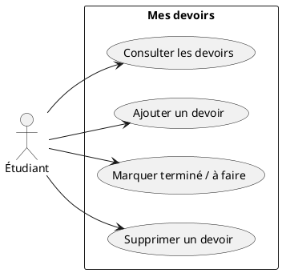

# Cas d’utilisation — Mes devoirs

## Acteur

- **Étudiant** : utilise l’application pour organiser le travail demandé dans ses cours.

## Cas d’utilisation

| Cas | Résultat attendu |
| --- | --- |
| Consulter les devoirs | L’étudiant voit les devoirs, leur cours et le nombre restant. |
| Ajouter un devoir | L’étudiant saisit un nom et un cours; l’application refuse les champs vides. |
| Marquer comme terminé / à faire | L’étudiant coche ou décoche un devoir; le compteur est actualisé. |
| Supprimer un devoir | L’étudiant retire un devoir de la liste. |

## Diagramme

## Scénario principal : ajouter un devoir

1. L’étudiant appuie sur **Nouveau devoir**.
2. Il saisit le nom du devoir et celui du cours.
3. Il appuie sur **Ajouter**.
4. L’application vérifie que les deux champs sont remplis.
5. Le devoir apparaît en haut de la liste et le compteur se met à jour.

**Alternative :** si un champ est vide, l’application affiche une validation et garde le formulaire ouvert.

## Limite actuelle

Les devoirs sont conservés en mémoire pendant l’utilisation de l’application. Ils sont réinitialisés à la fermeture; le stockage local pourra être ajouté comme prochain exercice.
